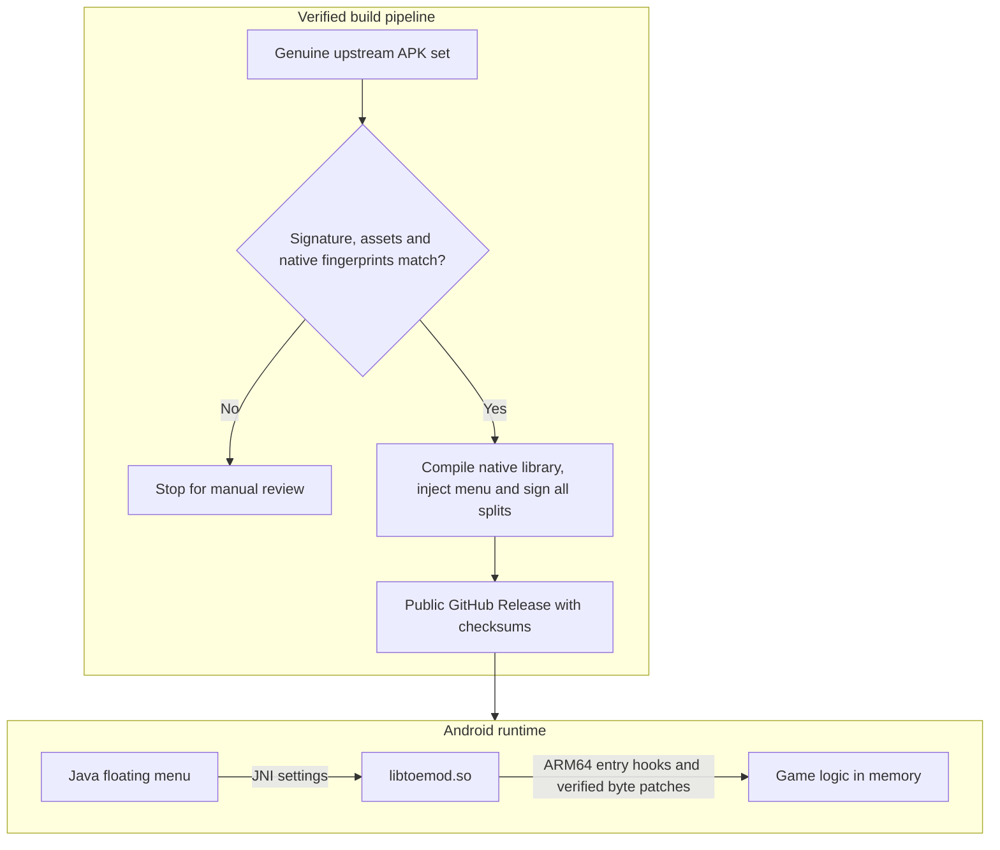

<div align="center">

<h1>TOE3 Stormline</h1>

<p></p>

<p><sub>Unofficial mod artwork, not a gameplay screenshot.</sub></p>

<p>
  <a href="https://github.com/ardzz/truckers-of-europe-3-mod/actions/workflows/mod-release.yml"></a>
  <a href="https://github.com/ardzz/truckers-of-europe-3-mod/releases/latest"></a>
  
</p>

<p>
  <a href="https://github.com/ardzz/truckers-of-europe-3-mod/releases/latest"><strong>Download the mod</strong></a>
  · <a href="#features">Features</a>
  · <a href="#how-it-works">How it works</a>
  · <a href="#in-app-updates">OTA updates</a>
  · <a href="#build-it-yourself">Build from source</a>
  · <a href="CHANGELOG.md">Changelog</a>
</p>

</div>

TOE3 Stormline is an Android reverse-engineering project that turns Truckers of Europe 3 into a configurable local sandbox. It started with two changes: keep the rain falling and stop the truck getting dirty. It now exposes **27 runtime controls** through a draggable in-game menu, with verified split-APK updates and an automated release pipeline.

The menu runs inside the game's activity. **No root or “display over other apps” permission required.** The packaged `libil2cpp.so` stays unchanged; the mod applies its hooks and patches in memory.

> **Compatibility:** reviewed for game **0.7.64 / build 193**, `arm64-v8a`. Unknown native code fails the build rather than receiving guessed patches. Google Play Games login and cloud saves do not work with the re-signed APK, including through microG.

## Features

| Category | Menu controls |
|---|---|
| Economy | Money, gold, wash tickets, level and XP overrides; ad-free and trailer-unlock flags |
| Weather & world | Clear, rainy, cloudy or foggy weather; clock hour, time freeze and AI traffic count |
| Truck | Engine power multiplier up to 10×; disable the high-speed auto-tow check |
| Damage | Prevent rain dirt; prevent truck and trailer/cargo collision damage; free and instant repairs |
| Fuel | Hold the current fuel level; free station and roadside refuelling |
| Driver | Fully rested fatigue value, without removing the sleep system |
| Jobs | Remove delivery penalties; income and XP multipliers up to 20×; rewarded-ad actions without the ad |
| Shopping & travel | Free trucks, parts, interiors, trailers and garages; free ferry, tolls and towing |

The floating panel has per-feature switches, value sliders and weather selection. Collapse it back to the draggable button to keep driving. Settings persist between launches, and the **Mods enabled** master switch disables every feature together.

Money, gold, wash tickets, level, rain and rain-dirt prevention are enabled by default. Other controls start disabled. Changes follow the game's update ticks or screen refreshes; disabling a control does not undo purchases, rewards or saved progress.

## How it works

**C++17 · Java 8 bytecode · JNI · Android NDK · IL2CPP · Apktool · GitHub Actions**



The native library waits for `libil2cpp.so` to load, installs entry hooks through [And64InlineHook](https://github.com/Rprop/And64InlineHook), and registers the controls exposed to Java. Byte patches check the original instructions before writing and restore them when disabled. Feature modules own separate hook addresses and patch ranges to avoid overlap.

The Java layer attaches framework views to `UnityPlayerActivity`, communicates through JNI, and stores configuration in SharedPreferences. It does not need a separate overlay service.

## Install

1. Open the [latest release](https://github.com/ardzz/truckers-of-europe-3-mod/releases/latest).
2. Download **all APK assets**, `compatibility.json`, `source.json`, `update.json` and `SHA256SUMS` into a dedicated folder.
3. Verify the files, then install the split set together:

```sh
sha256sum --check SHA256SUMS
adb install-multiple -r ./*.apk
```

`base.apk` alone is not a complete installation.

> **Before switching from the store version:** its signing certificate differs, so Android requires uninstalling it first. Uninstalling removes the local save. Back up anything recoverable before proceeding. Updates signed with the same mod key can install over the mod without an uninstall.

The source tree contains the mod code, not the game's APKs, extracted binaries or save files. Built APKs are distributed separately through public Releases.

## In-app updates

The Android launcher shows **TOE3 Stormline** and a gold-truck **MOD** icon. The package ID and signing key stay unchanged, so this updates the existing mod instead of creating a separate clone.

Install an OTA-enabled build manually once using the steps above. After that, open **Updates** in the mod menu: check the latest GitHub Release, download its complete APK set, and request installation. The updater checks file sizes and SHA-256 hashes, rejects older mod builds, and verifies that the downloaded base APK has the installed signing certificate and the build identity declared by the release.

Android always asks for installation confirmation. On Android 8+, it may first ask you to allow installs from this app; return to the game and press Install after granting that permission. No root or separate overlay permission is required, and silent installation is not supported. Save your game before installing because the app will close or restart. Updates download the full split set, not a small native hot patch.

## Automated releases

The workflow checks APKPure every day at **02:27 UTC / 09:27 WIB**, on mod or CI changes to `main`, and through **Actions → Mod build and release → Run workflow**. A manual run can select an exact upstream version; leaving the field blank selects the highest advertised version code.

Before building, CI verifies the original signing certificate, consistent split versions, the required `UnityDataAssetPack`, and the reviewed native-code, metadata and Unity hashes in [`ci/compatibility.json`](ci/compatibility.json). A changed fingerprint requires a reviewed port of the mod. Replacing the hashes alone does not update hook addresses or field offsets.

CI signs with an existing key, uploads all assets to a draft, and publishes only after the uploads finish. Each release includes the APK set, `SHA256SUMS`, a source manifest, a compatibility report and `update.json` for the in-app updater. Every APK carries the same build identity and required split inventory in its signed `assets/toemod/build.json`. A mod build number distinguishes updates even when the upstream game's version code stays the same. Re-running an already published build skips it instead of creating a duplicate.

<details>
<summary><strong>Configure signing for your own fork</strong></summary>

Set these repository Actions secrets:

| Secret | Value |
|---|---|
| `KEYSTORE_B64` | Base64-encoded signing keystore |
| `KS_PASS` | Keystore and private-key password |
| `KS_ALIAS` | Signing alias |

Keep the same key for future updates. The workflow refuses to generate a replacement identity. PR checks use read-only permissions and do not receive signing secrets.

APKPure is a third-party download source. CI checks the actual APK signatures against the pinned developer certificate rather than trusting the listing's certificate claim.

</details>

## Build it yourself

The toolchain uses **JDK 21**, **Apktool 2.12.1**, Android **build-tools 37.0.0**, **platform android-36.1** for compilation, and **NDK 30.0.16248370**, plus Python 3.10+, `curl` and `adb`. The app's minimum and target Android API levels remain those of the reviewed game build.

<details>
<summary><strong>Fetch, verify, build and install</strong></summary>

Run from the repository root with the Android SDK and NDK installed. The scripts accept `ANDROID_HOME` / `ANDROID_SDK_ROOT`, `ANDROID_NDK_HOME`, `BUILD_TOOLS`, `ANDROID_JAR` and `APKTOOL` overrides.

```bash
# Fetch the latest complete arm64 set and verify compatibility.
python3 ci/fetch_apk.py --output build/upstream
python3 ci/check_apks.py build/upstream

# Use an existing signing key. Store and private-key passwords must match here.
export KEYSTORE="$PWD/build/mod.keystore" KS_ALIAS=mod
read -r -s -p 'Keystore password: ' KS_PASS; export KS_PASS; echo

# Build, inject the menu, align and sign every split.
PULLED_DIR="$PWD/build/upstream" bash work/mod/build_release.sh

# Install over a build signed with the same key.
adb install-multiple -r work/mod/out/release/*.apk
```

For a first build without an existing key, create one deliberately before running the build script:

```sh
mkdir -p build
keytool -genkeypair -keystore build/mod.keystore -alias mod \
  -keyalg RSA -keysize 3072 -validity 10000 -dname 'CN=TOE3 Mod'
```

Enter the same password in the build step. Do not commit the keystore. A different key cannot update an existing installation signed with another key.

The build scripts also accept a genuine, compatible APK set pulled from your own device through `PULLED_DIR`. Already-modded input and incomplete split sets are rejected.

</details>

<details>
<summary><strong>Source map and reverse-engineering tools</strong></summary>

| Path | Responsibility |
|---|---|
| [`work/mod/src/`](work/mod/src/) | Native core and feature modules for economy, fuel, damage, fatigue, jobs, shopping, truck performance and world state |
| [`work/mod/src/mod.h`](work/mod/src/mod.h) | Shared feature, hook, memory-field and byte-patch API |
| [`work/mod/java/com/toemod/`](work/mod/java/com/toemod/) | Floating menu, controls and JNI bridge |
| [`work/mod/claims.txt`](work/mod/claims.txt) | Hook-entry and patch-range ownership |
| [`work/mod/build_native.sh`](work/mod/build_native.sh) | Compile `libtoemod.so` for arm64 |
| [`work/mod/build_base.sh`](work/mod/build_base.sh) | Inject the menu into the base APK |
| [`work/mod/build_release.sh`](work/mod/build_release.sh) | Compatibility-gated build, alignment, signing and output verification |
| [`ci/`](ci/) | Upstream fetcher, compatibility baseline, validation and regression tests |
| [`work/re.py`](work/re.py) | Method lookup, disassembly, caller search and field references over a local Cpp2IL dump |

The reviewed game uses Unity 2022.3 / IL2CPP. Mod addresses are virtual addresses; in this build's code segment, `vaddr = Cpp2IL RVA + 0x4000`. That mapping is build-specific, not a rule for arbitrary ELF files.

For reverse engineering, extract your own `libil2cpp.so` and `global-metadata.dat`, then generate an address-annotated C# dump with [Cpp2IL](https://github.com/SamboyCoding/Cpp2IL) using `--use-processor attributeinjector --output-as diffable-cs --output-to work/cs` alongside its binary, metadata and Unity-version arguments. The dump and extracted game files stay out of Git.

</details>

## Verification & limits

The offline suite covers download parsing, redirect boundaries, package identity, signatures, native compatibility and incomplete APK sets, with OTA metadata and update-policy checks alongside them:

```sh
python3 -m unittest discover -s ci -p 'test_*.py' -v
```

The [end-to-end release run](https://github.com/ardzz/truckers-of-europe-3-mod/actions/runs/38677161415) exercised fetching, compatibility checks, compilation, menu injection, signing and public publication. A [manual rerun](https://github.com/ardzz/truckers-of-europe-3-mod/actions/runs/38677407238) verified the existing-release skip path.

The menu and hook startup have been smoke-tested on an arm64 Huawei tablet. **Not every gameplay control has been exercised in play.** Passing CI proves packaging and signing checks, not complete gameplay correctness. Performance, traffic and reward changes need in-game testing before relying on them.

## Credits

- [Wanda Software](https://play.google.com/store/apps/details?id=com.WandaSoftware.TruckersofEurope3) created Truckers of Europe 3.
- [And64InlineHook](https://github.com/Rprop/And64InlineHook) by Rprop provides ARM64 inline hooking; its vendored files retain their MIT license notice.
- [Cpp2IL](https://github.com/SamboyCoding/Cpp2IL) provides the metadata and method-mapping workflow used during reverse engineering.
- [Apktool](https://github.com/iBotPeaches/Apktool) handles the Android bytecode round trip for menu injection.

Promotional artwork uses an AI-assisted scene based on a supplied truck reference. Typography and crops are reproducible with [`assets/artwork/render.py`](assets/artwork/render.py) (Pillow, fontconfig and DejaVu Sans). A [square cover](assets/artwork/mod-cover.png) and the [launcher icon](assets/artwork/launcher-icon.png) are available for project previews.

An independent project for personal, offline experimentation. Not affiliated with or endorsed by Wanda Software.
